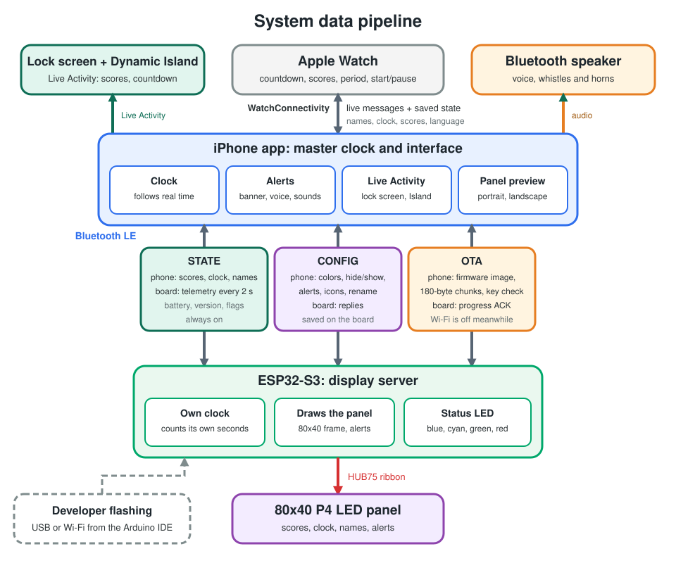

# BLEScoreboard Remote Control (iOS & watchOS App)

A native, low-latency iOS controller and watchOS extension built with **SwiftUI**, **CoreBluetooth**, and **WatchConnectivity**. This app serves as the master command center for the custom ESP32-S3 HUB75 LED Matrix Scoreboard, providing fluid score management, game clock sequencing, and device management right from your wrist or hand.

## ✨ Key Features

- **Find Scoreboards Screen:** Scans with an animated radar and lists nearby active scoreboards. Seamlessly link to your designated display to prevent interference on multi-court venues.
- **English & Spanish:** The interface, alerts and Bluetooth permission prompt are localized through string catalogs (`Localizable.xcstrings`, `InfoPlist.xcstrings`). You can rename the period unit (e.g., "Quarter", "Tiempo", "Half") and ordinals follow the phone's region via `NumberFormatter`. The LED panel font is ASCII-only, so accents are stripped on the panel (`Águilas` shows as `AGUILAS`) and the bottom line is compact (`Q2 07:45`). To add a language, add it to the string catalogs and the project's Localizations.
- **Board Renaming:** Give each scoreboard its own name from the connected screen (1-20 plain characters). The board saves it and restarts, and the app reconnects on its own.
- **Panel Colors:** The **Panel Colors** page (top card) sets the color of the timer (running and stopped), the period, each team's name and score, and the two start alerts, with a live LED preview. A switch on each row hides that element on the panel (an alert switched off does not play). The board saves the colors and what is hidden, and the app resends them on every connection.
- **Start Alerts:** When a game (period 1) or a later period starts from the full period length, the panel flashes its border and scrolls the period name with its ordinal (`1ST QUARTER`, `2DO PERIODO`, ... with the unit name you set) across the screen in the alert's color. Play buttons on the colors page try them in the preview and on the board.
- **Simulated Board:** A simulated panel at the bottom of the match screen shows the real match state: scores, clock, period, scrolling names, your colors and the start alerts. **Try the simulated board** on the scanner screen runs it without a board; with a real board linked it mirrors the board and shows whether the two clocks are in sync. The Apple Watch controls it too. **Turn the phone sideways** on the match screen and the simulated panel fills the screen with score, period and clock controls in one row below, and the screen stays on: the phone becomes the scoreboard if the real panel does not work.
- **Board Firmware over Bluetooth:** The **Board Firmware** page (top card, when linked) shows the firmware version on the board, the version carried by the app and the app's own version, and updates the board from the phone with a progress bar on the panel. The app proves itself to the board with a key it carries, so there is no password to type; the image and key come from `tools/bundle-firmware.sh` and are git-ignored.
- **Unified Master Clock Engine:** A centralized Swift background `Timer` manages the match clock countdown, eliminating data-stream collisions.
- **Accidental Disconnect Protection:** If the scoreboard drops power or loses connection mid-game, the timer continues ticking cleanly on your phone/watch. When the board is back, the app reconnects and resends the live state.
- **Live Hardware Telemetry:** Displays a color-coded battery percentage read from the scoreboard's resistor divider, and warns when the board's firmware is older than the app expects.
- **Immersive Visual & Haptic HUD Overlays:** Triggers crisp double-taps for period kickoffs, distinct warning pulses for intermissions, and a triple-whistle sequence for the final match completion across both the iPhone screen and the Apple Watch haptic core.

## 📖 Tutorial

New to the app? Read the [tutorial](docs/TUTORIAL.md) ([en español](docs/TUTORIAL.es.md)) or tap the **?** button inside the app.

## 🏷️ Versions

The app has a version (`MARKETING_VERSION`, for example 1.0.0) and a build number (`CURRENT_PROJECT_VERSION`), shared by the iPhone and Apple Watch targets and shown on the Find Scoreboards screen and the Board Firmware page of the iPhone app, and at the bottom of the Apple Watch screen. Bump **patch** for fixes, **minor** for compatible features and **major** for breaking changes, and raise the build number for every build you install. The board firmware has its own version, kept in the firmware repository; the app offers an update when the firmware it carries is newer than the board's. See [CHANGELOG.md](CHANGELOG.md).

Before building the app for a phone, run `tools/bundle-firmware.sh` to put the current firmware into `BLEScoreboard/Firmware/`. That folder contains your Wi-Fi and update passwords, so it is git-ignored: never commit it, and treat the built app as private.

## 🛠️ Xcode Deployment & Setup

### Requirements
- macOS running **Xcode 15+**
- A physical iPhone running **iOS 16+** and an paired Apple Watch running **watchOS 9+**

### Step-by-Step Configuration

1. **Clone the Repository:**
   ```bash
   git clone https://github.com/gerardoqm/BLEScoreboard.git
   ```
2. **Open the Workspace:** Open `BLEScoreboard.xcodeproj` in Xcode.
3. **Configure Code Signing (Crucial):**
   - Click the top-level project root (`BLEScoreboard`).
   - Open the **Signing & Capabilities** tab.
   - Check **"Automatically manage signing"**.
   - In the **Team** dropdown, select your personal Apple ID developer profile.
   - Under the *TARGETS* sidebar column on the left, click on **`ScoreboardWatch Watch App`** and select the exact same **Team Account Profile name** there as well.
4. **Deploy:** Plug your physical iPhone into your Mac via USB, select it in the target device dropdown menu, and click **Run (Play)**.

> 🔒 **Privacy Permissions Note:** The Bluetooth usage description is set in the iOS target's build settings (`INFOPLIST_KEY_NSBluetoothAlwaysUsageDescription`) and translated in `InfoPlist.xcstrings`. Without it iOS ends the app on first Bluetooth use.

> 📡 The byte-level Bluetooth protocol is documented in the firmware repository README (`scoreboard_BT_ESP32S3`). Update both together.


## 🧠 System data pipeline and over-the-air architecture

<p align="center"></p>

- **Apple Watch ↔ iPhone (WatchConnectivity).** The watch sends only what the user just changed (scores, period, start/pause, reset). The phone sends the whole match state, both as a live message and as a saved context the watch reads when it wakes, plus the team names.
- **The iPhone owns the clock.** It counts down against the real time the clock will reach zero, so it stays right when iOS suspends the app, and a notification announces half time and the end of the match even when the app is not on screen.
- **Alerts and sound.** For each event (goal, time left, match start, period start, period end, half time, match end) the app can speak or play a sound, show a banner, and send a panel alert, as set on the **Alerts and Sound** page. The voice and the whistles and horns go through the phone's current speaker, so a paired Bluetooth speaker works, and the app keeps announcing while it is in the background.
- **Live Activity.** Once the clock starts, the match shows on the lock screen and in the Dynamic Island, and iOS mirrors it on the Apple Watch. The countdown runs inside the widget; the app sends an update only when a score, the period or the clock state changes.
- **STATE characteristic.** Phone to board: an 8-byte header (scores, period, brightness, clock, running, total periods) followed by the team names. Board to phone: a 10-byte telemetry notification every 2 seconds (clock, period, battery, flags, protocol version, firmware version).
- **CONFIG characteristic.** Colors, hide/show, the start, period, half time and goal alerts, the goal and team-name emoji pictures, and board renaming. The board saves colors and visibility in flash.
- **OTA characteristic.** The firmware update over Bluetooth: a challenge handshake with the key the app carries, then the image in 180-byte chunks with a progress acknowledgement. The board switches Wi-Fi off while it runs, checks a CRC-32 and restarts by itself.
- **ESP32-S3.** A display server: it draws the 80x40 frame, counts its own seconds so the clock keeps running if the phone drops, and drives the status LED.

 📶 BLUETOOTH RADIO SYSTEM CHECK (Onboard WS2812B RGB NeoPixel)
 ──────────────────────────────────────────────────────────────
 
  [ SEARCHING_NEW ]  ──► (Blinks Blue 🔵) ──► Looking for phone app handshake.
         ▲
         │ (If 30-Second Limit Drops)
         │
  [ RETRYING_PAST ]  ──► (Blinks Cyan 🌐) ──► Signal dropout! Keep clock ticking 
         ▲                                    on phone while scanning to recover link.
         │ (If Accidental Drop Occurs)
         │
 [LINKED_CONNECTED] ──► (Solid Green 🟢) ──► BLE Sync Handshake Active.

 During a Bluetooth firmware update the LED blinks Red 🔴; when the new image is verified it turns Green and the board restarts by itself.
