# Tutorial de BLEScoreboard

Cómo vincular tu marcador y dirigir un partido con la app. El mismo recorrido está dentro de la app: toca el botón **?**.

> Las capturas se generan con el modo demo de depuración de la app (`-demo scanning|list|connected|simulate`, mira `tools/take-screenshots.sh`), por eso usan datos de ejemplo. [English version](TUTORIAL.md)

## 1. Encuentra tu marcador

Enciende el marcador y abre la app. El radar busca marcadores cercanos y el LED del marcador **parpadea en azul** mientras espera a tu teléfono. Mantén el Bluetooth activado y el teléfono cerca.

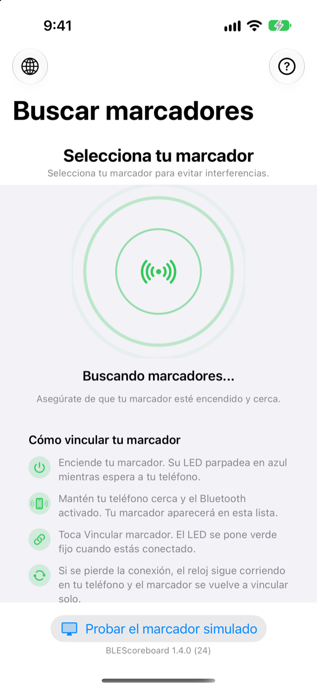

Si el Bluetooth está apagado, la pantalla te lo indica en lugar de mostrar el radar.

## 2. Vincúlalo

Los marcadores aparecen en la lista al encontrarse y la app sigue buscando más. Toca **Vincular marcador** junto a tu marcador; si hay varias canchas, elige el nombre que le diste. El LED se pone **verde fijo** cuando estás conectado.

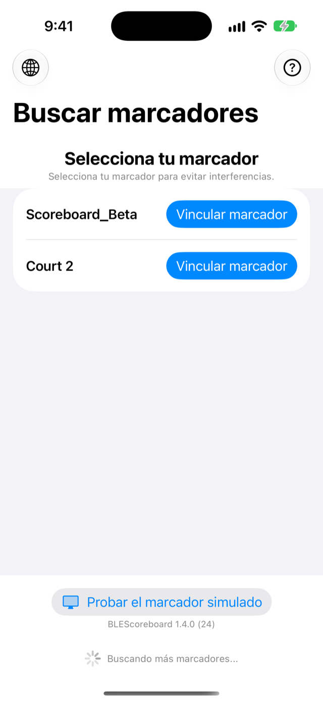

## 3. Dirige el partido

La tarjeta superior muestra el estado de la conexión, el nombre del marcador, su batería (junto al nombre del periodo) y los controles de **Firmware del marcador**, **Colores del panel** y brillo. Debajo están los nombres de los equipos y un solo cuadro con el título del periodo, los dos marcadores, la cuenta regresiva y los controles de periodo. **Iniciar**, **Pausar** y el botón de reinicio controlan la cuenta regresiva, y el control de minutos define la duración del periodo. El reloj sigue la hora real de tu teléfono, así que el partido continúa aunque se pierda la conexión o iOS suspenda la app. Cuando el marcador vuelve, la app se vincula de nuevo y reenvía el estado.

Cada vez que sube un marcador, desde el teléfono o el reloj, se muestra una animación **Gol de <equipo>** en el teléfono y en el panel, con el emoji que elijas en Colores del panel.

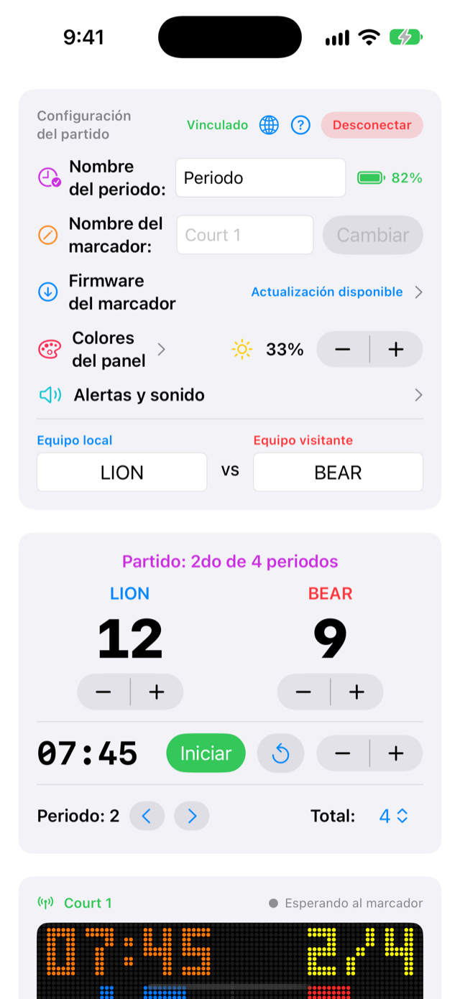

## 4. Configura el partido

Usa las flechas junto a **Periodo** para ir al periodo anterior o al siguiente (el reloj se detiene y muestra el periodo siguiente completo, listo para iniciar), y el menú **Total** para el número de periodos. El brillo del panel está junto a **Colores del panel**. En la tarjeta superior puedes cambiar el nombre del periodo (por ejemplo Cuarto, Mitad o Tiempo), escribir emojis en los nombres de los equipos y darle un nombre al marcador con **Cambiar**: el marcador lo guarda, se reinicia y se vuelve a vincular. Los nombres del marcador usan solo caracteres simples (de 1 a 20).

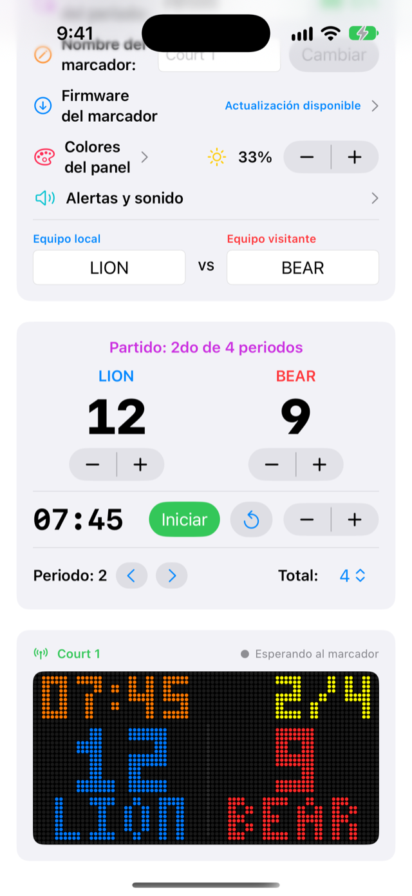

## 5. Elige los colores del panel

Toca **Colores del panel** en la tarjeta superior. Elige el color del reloj (en marcha y detenido), el periodo, el nombre y los puntos de cada equipo, y las dos alertas de inicio, con las muestras o con cualquier color del selector. La vista previa de arriba muestra el panel mientras eliges. El marcador guarda los colores y la app los envía de nuevo cada vez que te conectas. Usa el interruptor de una fila para **ocultar** ese elemento en el panel (el interruptor del reloj lo oculta tanto en marcha como detenido); una alerta apagada no se reproduce. La vista previa y el marcador simulado lo ocultan al instante. **Restablecer colores** vuelve a los colores predeterminados y deja los interruptores como están.

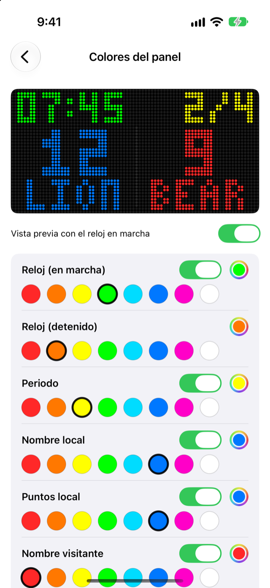

## 6. Alertas de inicio

Cuando empieza un partido (periodo 1) o un periodo posterior, el panel hace parpadear su borde y desplaza el nombre del periodo con su ordinal (`1ER TIEMPO`, `2DO PERIODO`, `3ER CUARTO`... o el nombre que hayas puesto) por la pantalla a triple tamaño, en el color de la alerta, y luego vuelve al marcador. La alerta suena cuando el reloj arranca desde la duración completa del periodo; al reanudar tras una pausa no se repite. En la página de colores, **Probar alerta de inicio** y **Probar alerta de periodo** las prueban en la vista previa y en tu marcador.

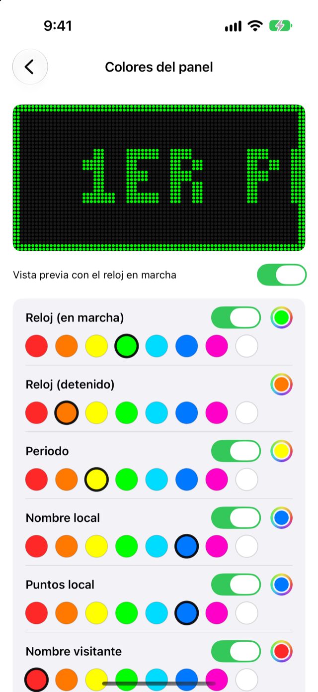

 

## 7. Apple Watch y alertas

La app del Watch te permite sumar o restar puntos (− y + para cada equipo), cambiar el periodo e iniciar o pausar el reloj desde tu muñeca. Sigue a tu teléfono, así que ambos muestran siempre el mismo marcador. Un aviso y un toque en tu teléfono y tu reloj indican cuándo empieza un periodo y cuándo termina el partido.

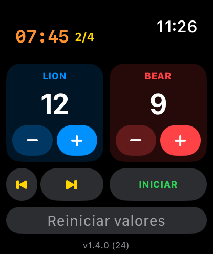

## 8. Prueba el marcador simulado

¿No tienes un marcador a la mano, o quieres ver un partido completo? En la pantalla Buscar marcadores toca **Probar el marcador simulado**. La pantalla del partido funciona igual. Al final, un panel simulado muestra lo mismo que el marcador real: puntos, reloj, periodo, nombres de los equipos (que se desplazan si no caben), tus colores y las alertas de inicio. Debajo hay botones de puntos, periodo e inicio/pausa, y el Apple Watch también lo controla.

Cuando hay un marcador real vinculado, el panel simulado es la vista previa en vivo de ese marcador: el marcador refleja la app y una línea de estado muestra **Marcador sincronizado** cuando el reloj del propio marcador coincide. **Salir del simulador** (tarjeta superior) vuelve a la lista de marcadores.

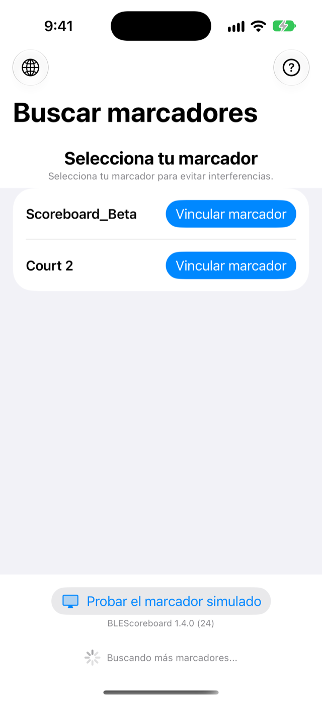 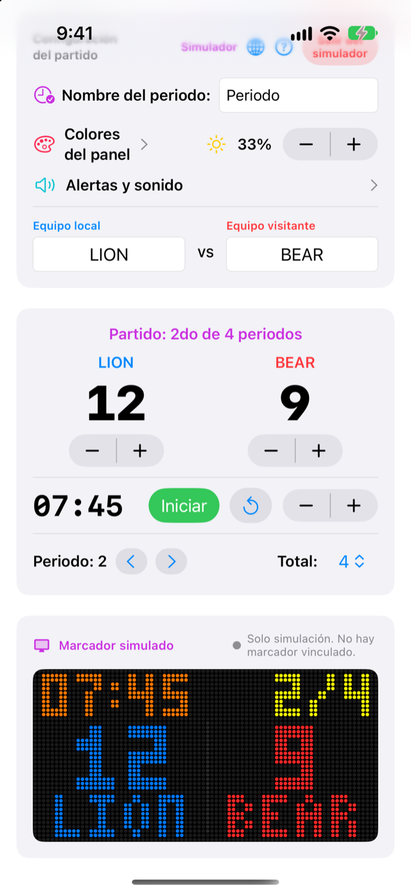

## 9. Actualiza el firmware del marcador

Abre **Firmware del marcador** en la tarjeta superior. Muestra el firmware del marcador y el que trae la app, y actualiza el marcador por Bluetooth con una barra de progreso en el panel. El LED parpadea en rojo durante la actualización, se pone verde cuando la nueva imagen se verifica y el marcador se reinicia solo.

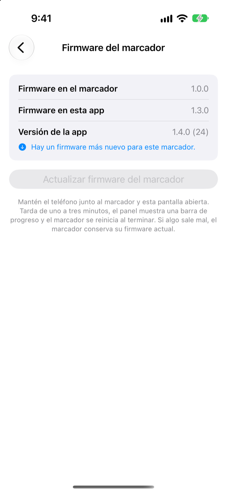

## 10. Marcador en horizontal

Gira el teléfono en la pantalla del partido y el panel simulado ocupa toda la pantalla, con los controles de puntos, periodo y reloj en una fila debajo. La pantalla se mantiene encendida, así que el teléfono funciona como marcador si el panel real no funciona.

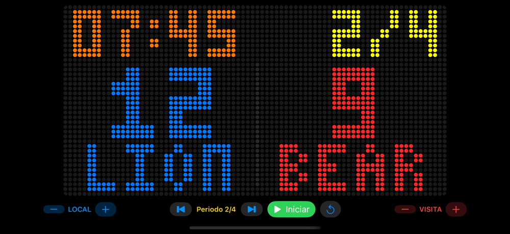

## 11. Idioma

El botón del globo (arriba a la izquierda en Buscar marcadores, y en la tarjeta superior de la pantalla del partido) fuerza inglés o español, o sigue el idioma del teléfono. El cambio se aplica al instante en toda la app, las alertas del panel y el Apple Watch.

## 12. Alertas y sonido

Abre **Alertas y sonido** en la tarjeta superior. Para cada evento (gol, tiempo restante, inicio del partido, inicio de periodo, fin de periodo, medio tiempo, fin del partido) elige por separado el **Audio**, el **Aviso** en la app y el **Panel**, y toca el botón de reproducir para probarlo. El teléfono dice los goles ("Gol de Blancos") y el tiempo restante ("quedan 5 minutos"), y suena un silbato de árbitro en los periodos y una bocina al inicio y al final del partido, en el idioma de la app. Elige los minutos a anunciar (de 1 a 15), escoge una voz (una voz mejorada o premium de Ajustes > Accesibilidad > Contenido hablado suena mucho más natural) y envía todo a un altavoz Bluetooth: vincúlalo en los Ajustes de iOS y elígelo con el botón del altavoz.

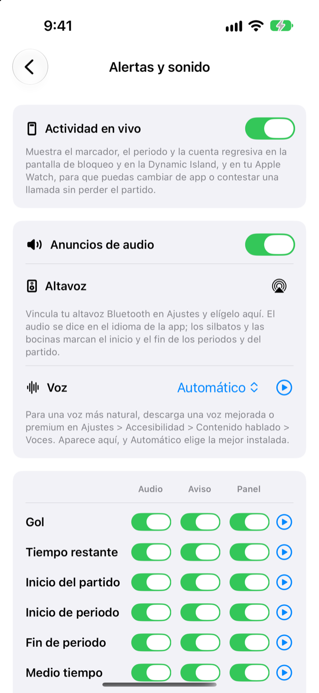

## 13. Actividad en vivo

Cuando arranca el reloj, el partido se queda en la pantalla de bloqueo y en la Dynamic Island (marcador, periodo y cuenta regresiva), y en tu Apple Watch, para que puedas cambiar de app o contestar una llamada sin perder el hilo. Termina cuando te desconectas, o 15 minutos después del silbatazo final. Se desactiva con el interruptor **Actividad en vivo** de la página de alertas y sonido.

## Solución de problemas

| Problema | Qué probar |
| :--- | :--- |
| El marcador no aparece | Revisa que esté encendido y su LED parpadee en azul, que el Bluetooth esté activado, y desliza la lista hacia abajo para buscar de nuevo. |
| "El firmware del marcador está desactualizado" | Carga el firmware más reciente del repositorio `scoreboard_BT_ESP32S3` (por USB, o por Wi-Fi con la dirección IP). |
| El LED parpadea en cian | Se perdió la conexión. El marcador espera 30 segundos al mismo teléfono y luego se reinicia y vuelve a azul. |
| Los colores, las alertas o los elementos ocultos no hacen nada en el panel | El marcador necesita el firmware más reciente (versión de protocolo 4). La página de colores muestra un aviso cuando es anterior. |
| Cambiar el nombre no hace nada | El marcador necesita el firmware actual; la línea de estado bajo el campo indica el motivo. |
