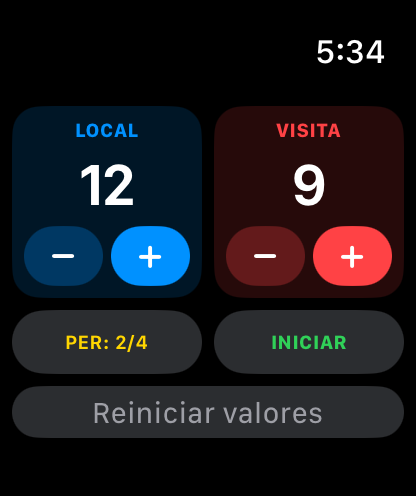

# Tutorial de BLEScoreboard

Cómo vincular tu marcador y dirigir un partido con la app. El mismo recorrido está dentro de la app: toca el botón **?**.

> Las capturas se generan con el modo demo de depuración de la app (`-demo scanning|list|connected|connected-bottom`), por eso usan datos de ejemplo. [English version](TUTORIAL.md)

## 1. Encuentra tu marcador

Enciende el marcador y abre la app. El radar busca marcadores cercanos y el LED del marcador **parpadea en azul** mientras espera a tu teléfono. Mantén el Bluetooth activado y el teléfono cerca.

Si el Bluetooth está apagado, la pantalla te lo indica en lugar de mostrar el radar.

## 2. Vincúlalo

Los marcadores aparecen en la lista al encontrarse y la app sigue buscando más. Toca **Vincular marcador** junto a tu marcador; si hay varias canchas, elige el nombre que le diste. El LED se pone **verde fijo** cuando estás conectado.

## 3. Dirige el partido

La tarjeta superior muestra el estado de la conexión, la batería del marcador y su nombre. Debajo están los nombres de los equipos, los botones de puntos y el reloj. **Iniciar**, **Pausar** y **Reiniciar reloj** controlan la cuenta regresiva, y el control de minutos define la duración del periodo. El reloj corre en tu teléfono, así que el partido continúa aunque se pierda la conexión. Cuando el marcador vuelve, la app se reconecta y reenvía el estado actual.

## 4. Configura el partido

Elige el periodo actual, el total de periodos y el brillo del panel. En la tarjeta superior puedes cambiar el nombre del periodo (por ejemplo Cuarto, Mitad o Tiempo) y darle un nombre al marcador con **Cambiar**: el marcador lo guarda, se reinicia y se vuelve a vincular. Los nombres usan solo caracteres simples (de 1 a 20) y el panel muestra los nombres de los equipos sin acentos.

## 5. Apple Watch y alertas

La app del Watch te permite sumar o restar puntos (− y + para cada equipo), cambiar el periodo e iniciar o pausar el reloj desde tu muñeca. Sigue a tu teléfono, así que ambos muestran siempre el mismo marcador. Un aviso y un toque en tu teléfono y tu reloj indican cuándo empieza un periodo y cuándo termina el partido.

## Solución de problemas

| Problema | Qué probar |
| :--- | :--- |
| El marcador no aparece | Revisa que esté encendido y su LED parpadee en azul, que el Bluetooth esté activado, y desliza la lista hacia abajo para buscar de nuevo. |
| "El firmware del marcador está desactualizado" | Carga el firmware más reciente del repositorio `scoreboard_BT_ESP32S3` (por USB, o por Wi-Fi con la dirección IP). |
| El LED parpadea en cian | Se perdió la conexión. El marcador espera 30 segundos al mismo teléfono y luego se reinicia y vuelve a azul. |
| Cambiar el nombre no hace nada | El marcador necesita el firmware actual; la línea de estado bajo el campo indica el motivo. |
