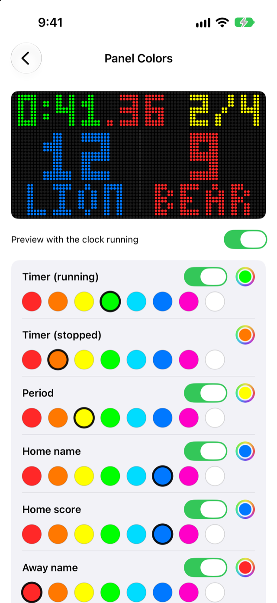
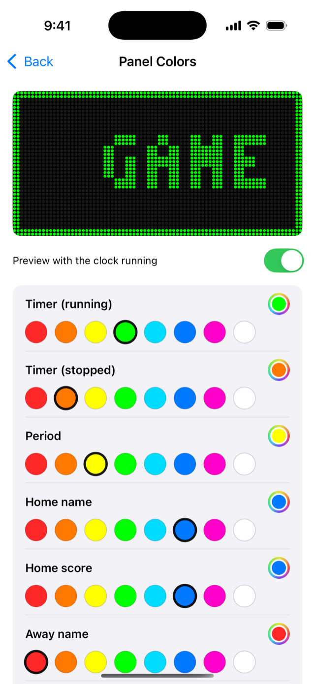
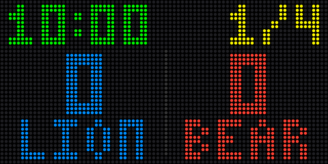
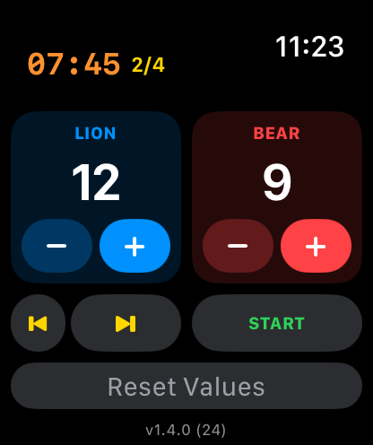
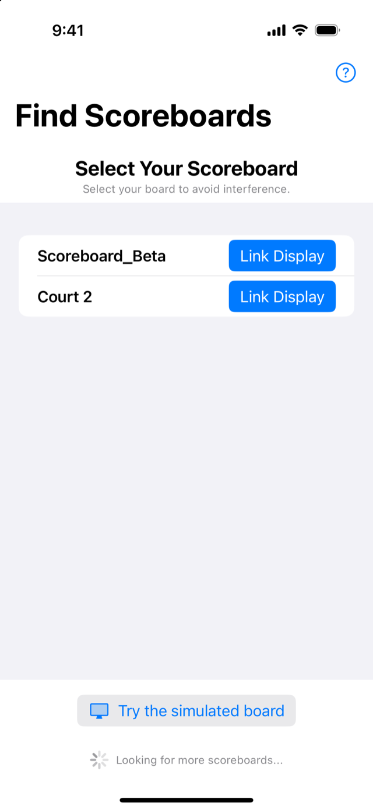
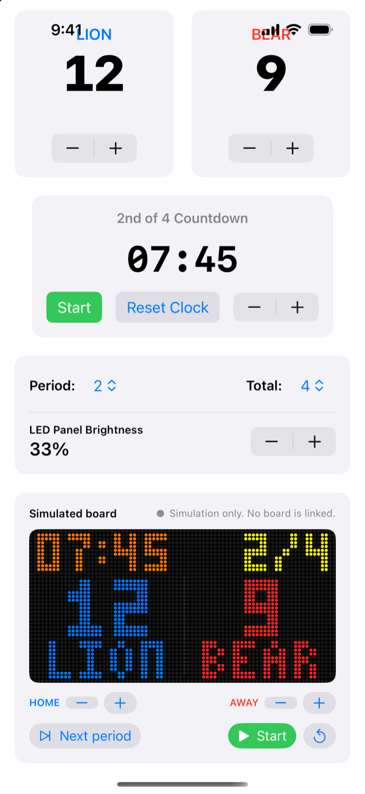

# BLEScoreboard tutorial

How to link your scoreboard and run a game with the app. The same walkthrough is built into the app: tap the **?** button.

> Screenshots are generated from the app's debug demo mode (`-demo scanning|list|connected|connected-bottom`), so they use sample data. [Versión en español](TUTORIAL.es.md)

## 1. Find your scoreboard

Power on the board and open the app. The radar searches for nearby scoreboards, and the board's LED **blinks blue** while it waits for your phone. Keep Bluetooth on and the phone close.

If Bluetooth is off, the screen tells you so instead of showing the radar.

## 2. Link it

Boards appear in the list as they are found, and the app keeps looking for more. Tap **Link Display** next to your own board; at a venue with several courts, pick the board name you gave it. The LED turns **solid green** when you are connected.

## 3. Run the game

The top card shows the link status, the board's battery and the board name. Below it are the team names, the score steppers and the clock. **Start**, **Pause** and **Reset Clock** control the countdown, and the minutes stepper sets the period length. The clock runs on your phone, so the game keeps going if the link drops. When the board is back, the app relinks and resends the live state.

## 4. Set up the match

Choose the current period, the total number of periods and the panel brightness. In the top card you can rename the period unit (for example Quarter, Half or Tiempo) and give the board its own name with **Rename**: the board saves it, restarts and relinks. Names use plain characters only (1 to 20), and the panel shows team names without accents.

## 5. Choose panel colors

Tap **Panel Colors** in the top card. Pick the color of the timer (running and stopped), the period, each team's name and score, and the two start alerts, using the swatches or any color from the color picker. The preview at the top shows the panel as you choose. The board saves the colors, and the app sends them again every time you connect. **Reset colors** goes back to the defaults.

## 6. Start alerts

When a game starts (period 1) or a later period starts, the panel flashes its border and scrolls `GAME START` or `PERIOD 2` across the screen at triple size, in the alert's color, then returns to the scoreboard. The alert plays when the clock starts from the full period length; resuming after a pause does not repeat it. On the colors page, **Play game start alert** and **Play period start alert** try them in the preview and on your board.

 

## 7. Apple Watch and alerts

The Watch app lets you add or subtract points (− and + for each team), change the period and start or pause the clock from your wrist. It follows your phone, so both always show the same score. A banner and a tap on your phone and watch announce when a period starts and when the match ends.

## 8. Try the simulated board

No board at hand, or want to see a whole match? On the Find Scoreboards screen tap **Try the simulated board**. The match screen works the same way. At the bottom, a simulated panel shows what the real board shows: scores, clock, period, team names (scrolling when they don't fit), your colors and the start alerts. Under it are score, period and start/pause buttons, and the Apple Watch controls it too.

When a real board is linked, the simulated panel is the live preview of that board: the board mirrors the app, and a status line shows **Board in sync** when the board's own clock matches. **Exit simulator** (top card) goes back to the board list.

 

## Troubleshooting

| Problem | What to try |
| :--- | :--- |
| The board does not appear | Check that it is powered and its LED blinks blue, that Bluetooth is on, and pull down on the list to rescan. |
| "Board firmware is outdated" | Flash the latest firmware from the `scoreboard_BT_ESP32S3` repository (USB, or Wi-Fi by IP address). |
| The LED blinks cyan | The link dropped. The board waits 30 seconds for the same phone, then resets and goes back to blue. |
| Colors or alerts do nothing on the panel | The board needs the latest firmware (protocol version 3). The colors page shows a warning when it is older. |
| Rename does nothing | The board needs current firmware; the status line under the field shows why. |
