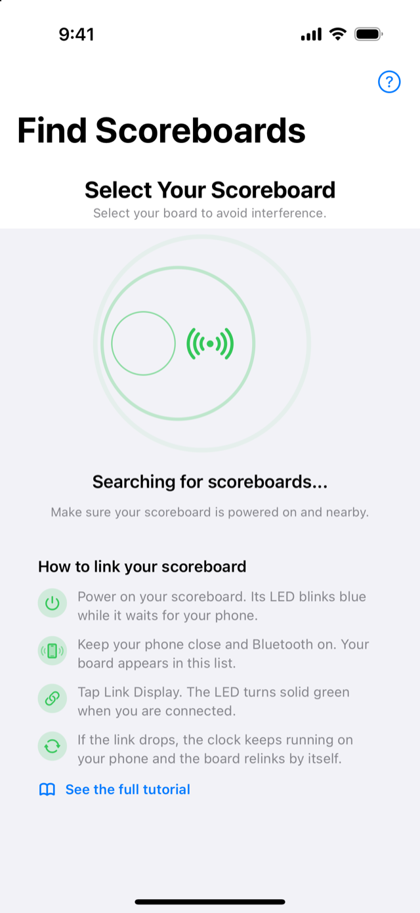
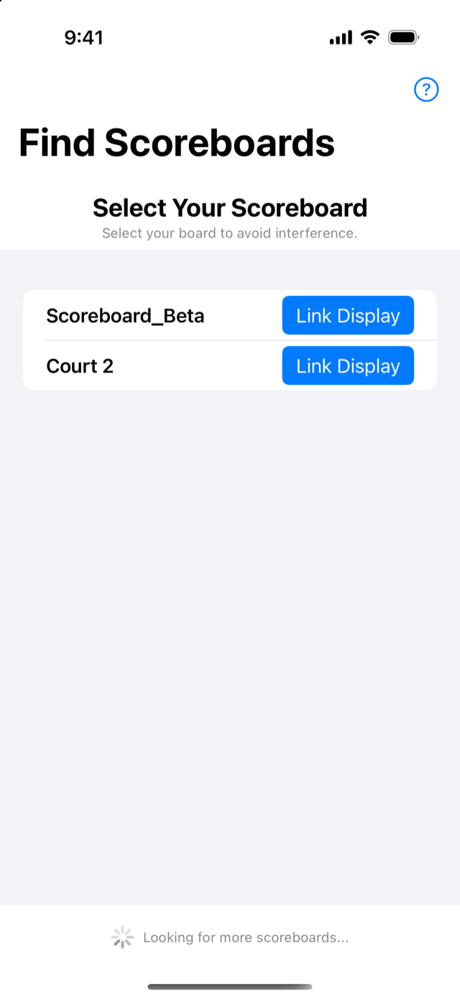
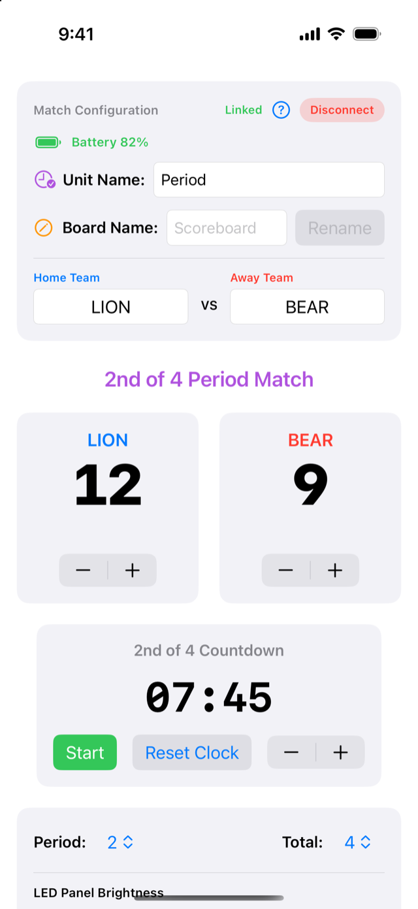
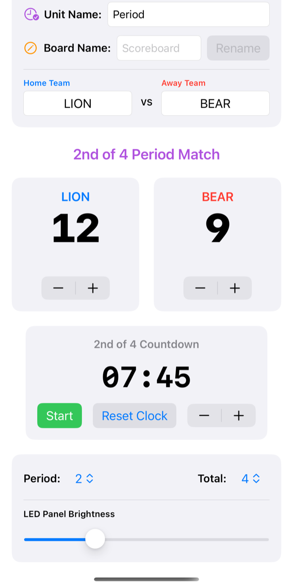

# BLEScoreboard tutorial

How to link your scoreboard and run a game with the app. The same walkthrough is built into the app: tap the **?** button.

> Screenshots are generated from the app's debug demo mode (`-demo scanning|list|connected|connected-bottom`), so they use sample data. [Versión en español](TUTORIAL.es.md)

## 1. Find your scoreboard

Power on the board and open the app. The radar searches for nearby scoreboards, and the board's LED **blinks blue** while it waits for your phone. Keep Bluetooth on and the phone close.

If Bluetooth is off, the screen tells you so instead of showing the radar.

## 2. Link it

Boards appear in the list as they are found, and the app keeps looking for more. Tap **Link Display** next to your own board; at a venue with several courts, pick the board name you gave it. The LED turns **solid green** when you are connected.

## 3. Run the game

The top card shows the link status, the board's battery and the board name. Below it are the team names, the score steppers and the clock. **Start**, **Pause** and **Reset Clock** control the countdown, and the minutes stepper sets the period length. The clock runs on your phone, so the game keeps going if the link drops. When the board is back, the app relinks and resends the live state.

## 4. Set up the match

Choose the current period, the total number of periods and the panel brightness. In the top card you can rename the period unit (for example Quarter, Half or Tiempo) and give the board its own name with **Rename**: the board saves it, restarts and relinks. Names use plain characters only (1 to 20), and the panel shows team names without accents.

## 5. Apple Watch and alerts

The Watch app adds points, changes the period and starts or pauses the clock from your wrist. A banner and a tap on your phone and watch announce when a period starts and when the match ends.

## Troubleshooting

| Problem | What to try |
| :--- | :--- |
| The board does not appear | Check that it is powered and its LED blinks blue, that Bluetooth is on, and pull down on the list to rescan. |
| "Board firmware is outdated" | Flash the latest firmware from the `scoreboard_BT_ESP32S3` repository (USB, or Wi-Fi by IP address). |
| The LED blinks cyan | The link dropped. The board waits 30 seconds for the same phone, then resets and goes back to blue. |
| Rename does nothing | The board needs current firmware; the status line under the field shows why. |
